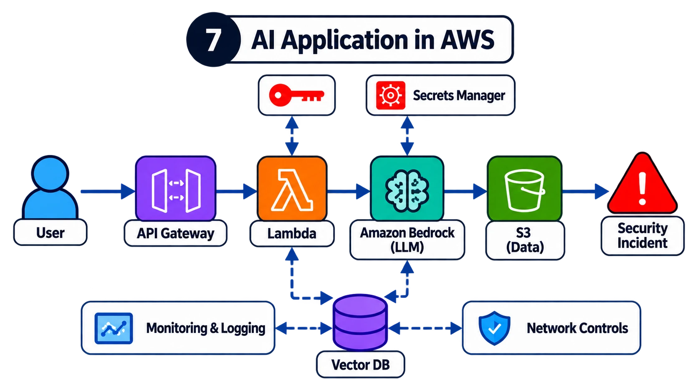

# 7. How would you secure AI models and data in the cloud?

## The answer

AI security still depends heavily on **traditional cloud security fundamentals**.

For an AWS application (User → API Gateway → Lambda → Amazon Bedrock → S3, plus a vector DB), assess:

- **IAM**: is the Lambda role scoped to specific Bedrock models and S3 prefixes, or does it have `bedrock:*` and `s3:*`?
- **Network**: are model endpoints and the vector DB reached privately (VPC endpoints / PrivateLink) or over the public internet?
- **Encryption**: KMS keys for S3, the vector store, logs and any fine-tuning data; who can use those keys?
- **Secrets**: API keys and DB credentials in Secrets Manager with rotation, not in environment variables or code.
- **Logging**: CloudTrail for control-plane calls, Bedrock model-invocation logging where appropriate, API Gateway access logs.
- **Model endpoint access**: who and what can invoke which models; custom/fine-tuned models locked down.

Then look at the **AI-specific data lifecycle**: how training data, inference requests and model outputs are processed, where they're stored and how long they're kept. Prompts and completions often contain the most sensitive data in the system.

If the application uses Amazon Bedrock, review its security configuration: service permissions, guardrails, invocation logging destinations, cross-account access and the data paths between services.

## Review checklist

| Area | Check | Common finding |
| --- | --- | --- |
| IAM | Lambda role limited to `bedrock:InvokeModel` on named model ARNs | Wildcard `bedrock:*` / `Resource: *` |
| IAM | S3 access scoped to required prefixes, read-only where possible | Full-bucket write from the inference path |
| Network | VPC endpoints for Bedrock, S3, Secrets Manager | Public egress from Lambda |
| Network | Vector DB not publicly reachable | Open security group / public endpoint |
| Data | S3 Block Public Access, SSE-KMS, bucket policy denies non-TLS | Default encryption only, no key policy review |
| Secrets | Secrets Manager with rotation; no secrets in env vars | API keys in Lambda environment |
| Logging | CloudTrail on, invocation logs to an access-restricted bucket | Prompts with PII logged to a widely readable bucket |
| Retention | Defined retention for prompts, outputs, embeddings | Indefinite retention "for debugging" |
| Edge | API Gateway auth, WAF, throttling | Unauthenticated endpoint, no rate limit (cost abuse) |

## What I'd demonstrate

A cloud architecture review identifying excessive permissions, exposed components and missing security controls, with each finding mapped to a fix (for example, an IAM policy diff).

## Follow-ups to expect

- Should you enable model-invocation logging, given it captures sensitive prompts?
- How would you stop a compromised Lambda running up a huge Bedrock bill?
- What does the shared responsibility model look like for a managed LLM service?
- How would you detect a poisoned file landing in the S3 ingestion bucket?
