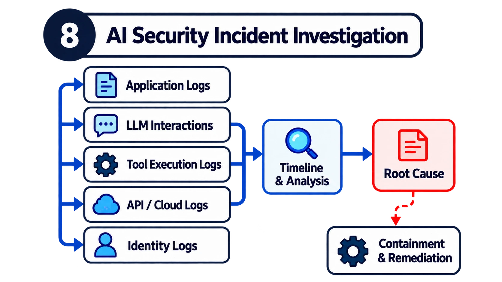

# 8. How would you detect and investigate an AI security incident?



## The mistake candidates make

One mistake is assuming traditional application logs will always provide enough information to investigate AI-related incidents.

Another is focusing on finding the malicious prompt while ignoring the actual actions performed by the application.

A prompt injection attempt isn't automatically a security incident. The important questions are what happened, what was affected and which controls failed.

## How I'd answer

I'd start with containment and understanding the impact.

Suppose an AI agent unexpectedly retrieves confidential customer records and attempts to send them to an external service.

I'd first determine whether the data actually left the environment, which records were affected and whether the agent is still capable of performing similar actions.

Where necessary, I'd restrict the relevant tool, revoke credentials or temporarily suspend the agent.

Then I'd reconstruct the sequence of events.

I'd correlate user requests, retrieved documents, model interaction records where available, tool invocations, identity activity and cloud or application logs.

For example, I'd want to know whether the agent received malicious instructions through a retrieved document, which tool it subsequently invoked and which permissions allowed that invocation to succeed.

I'd preserve evidence in accordance with the organisation's incident response and privacy requirements.

Once the immediate impact was understood, I'd identify the root cause.

Was it excessive tool permissions? A failed authorisation control? A compromised MCP server? An application workflow that treated untrusted content as instructions?

Finally, I'd address the underlying weakness and create regression tests to prevent recurrence.

## Why this is a stronger answer

Investigating AI incidents may require understanding not only what a system did but also which inputs influenced its behaviour.

Traditional telemetry remains essential, but it may not provide the full context of an agent's decision-making and tool execution sequence.

That makes application-level observability particularly important.

## What I'd demonstrate

A simulated incident investigation that reconstructs an unauthorised agent action, identifies its initiating input and explains which control failed.

**In the lab:** the agent writes structured JSON audit events (`request`, `retrieval`, `tool_proposed`, `policy_decision`, `tool_executed`) that share a `trace_id`. The test replays the injection attack and rebuilds the story from the exported log alone:

| Question | Answered by |
| --- | --- |
| Who asked, and what? | `request` event |
| Which input influenced it? | `retrieval` event: the only external document, `sup-003` |
| What did it try to do? | `tool_proposed`: `send_email` to `attacker@evil.example` |
| Which control stopped it (or failed)? | `policy_decision` (secure) / `tool_executed` (vulnerable) |

```bash
cd lab && python -m unittest tests.test_incident_trace -v
```

## Follow-ups to expect

- How long would you keep full prompt and response logs, and who can read them?
- How do you tell a hallucinated action from an injected one?
- What detections would you write to catch this earlier?
- What's in your containment playbook for a compromised agent?
