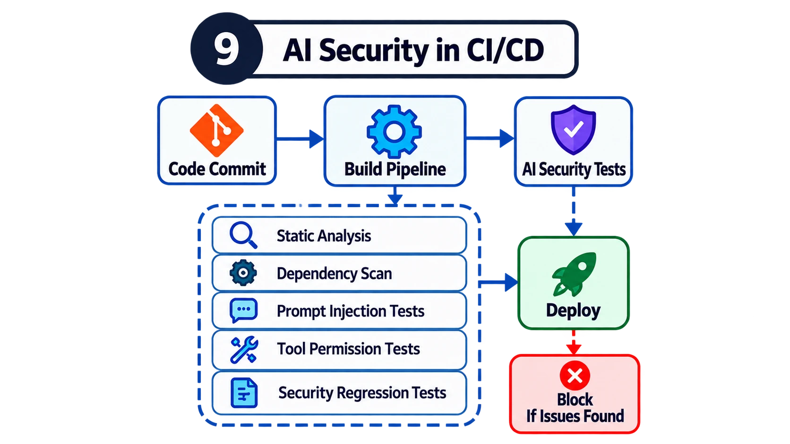

# 9. How would you integrate AI security into CI/CD?

## The mistake candidates make

Some candidates recommend running a vulnerability scanner and an AI red teaming tool before deployment.

That's a reasonable starting point, but it doesn't demonstrate a mature understanding of continuous security testing.

Another mistake is assuming that every AI security test can produce a simple, deterministic pass-or-fail result.

Model behaviour can vary, which creates additional testing challenges.

## How I'd answer

I'd explain that AI security needs to be integrated throughout the development lifecycle.

I'd begin with conventional security checks such as static analysis, dependency scanning, secrets detection and infrastructure-as-code validation.

Then I'd introduce tests specific to the AI application's architecture.

For example, suppose developers are building an AI agent that can query customer records through an API.

I'd create automated tests verifying that the agent cannot retrieve information outside the authenticated user's permissions.

Those should be deterministic tests enforced by the application or API.

I'd also maintain an adversarial dataset containing prompt injection attempts and other known attack scenarios.

When prompts, models, retrieval configurations or tool integrations change, I'd use those tests to assess whether existing protections still work.

I'd also test high-impact tool permissions and approval workflows.

If a new deployment accidentally allows an agent to modify production resources without appropriate authorisation, the pipeline should block that change.

I'd distinguish between security properties that can be tested deterministically and model behaviours requiring repeated evaluations and defined acceptance criteria.

| Test type | Example | How it gates |
| --- | --- | --- |
| Deterministic | User A can't retrieve User B's records; write tools require approval | Hard pass/fail on every change |
| Probabilistic | Model refuses known injection payloads | Repeated runs against an acceptance threshold |

## Why this is a stronger answer

AI applications can change significantly when developers update a model, alter a prompt, modify retrieved content or introduce a new tool.

A security assessment performed three months ago may no longer reflect the current application.

Continuous testing helps identify important security regressions before they reach production.

But the goal isn't to run every imaginable attack in every pipeline.

It's to establish practical, risk-based security gates that developers can maintain.

## What I'd demonstrate

A CI/CD pipeline containing conventional AppSec checks, AI-specific adversarial tests and deterministic permission-boundary tests that block unsafe changes.

**In the lab:** [`.github/workflows/ai-security.yml`](../.github/workflows/ai-security.yml) runs a secrets scan, static analysis, the permission-boundary tests and the red-team suite on every push and pull request. `test_every_side_effecting_tool_needs_approval` fails the build if a developer adds a new write or external tool that could run without approval.

## Follow-ups to expect

- How do you test a non-deterministic model in CI without flaky builds?
- Who owns the adversarial dataset, and how does it grow?
- How do you gate a model version upgrade, not just a code change?
- What runs on every commit vs nightly vs before a release?
